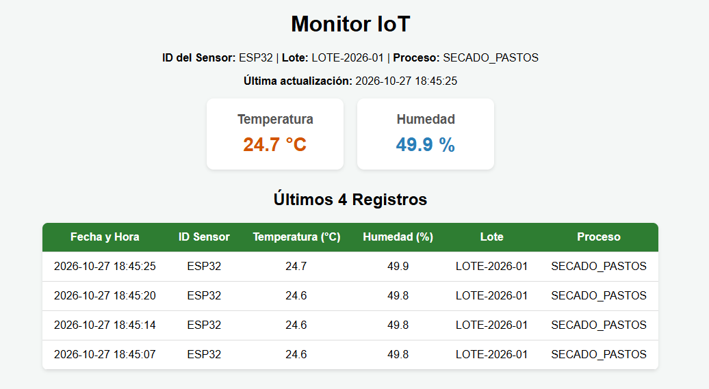
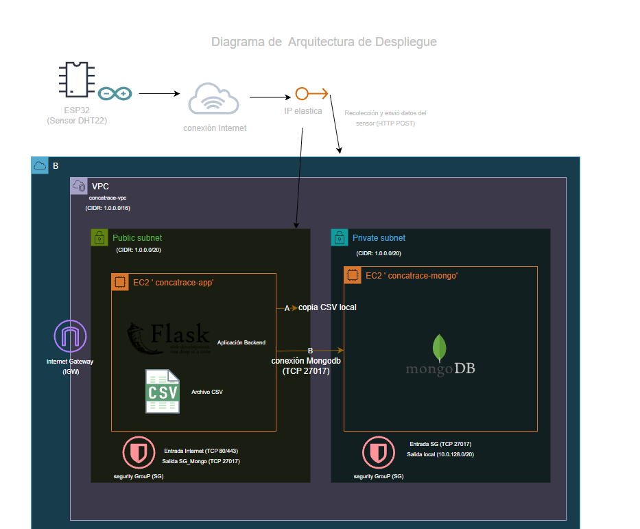

# Monitor IoT: temperatura y humedad con ESP32

Servidor Flask que recibe las mediciones ( temperatura y humedad )  de un ESP32 con sensor DHT22 y las guarda en **MongoDB** y en un **CSV**. Es parte del proyecto de trazabilidad de bioproductos de hoja de coca: cada lectura queda asociada a un lote y a una etapa, que puede ser secado o almacenamiento.

## Integrantes
* Valentina Arciniegas
* Davinson Tulande
* Carlos Daza
* Andres Coral
## Estructura

## Estructura

```
proyecto_iot/
├── app.py                  # API y dashboard (Flask)
├── config.py               # Configuración por variables de entorno
├── services/
│   ├── csv_service.py      # Escritura y lectura del CSV
│   └── mongo_service.py    # Conexión e índices de MongoDB
├── templates/index.html    # Dashboard (se actualiza cada 5 s)
├── static/css/styles.css
├── data/mediciones.csv     # Se crea automáticamente
├── firmware/cocatrace_th/  # Código del ESP32 (Arduino)
├── docs # tiene manuales, guías o capturas de pantalla.
└── requirements.txt
```

## Hardware y firmware

- ESP32 DevKit + DHT22 (`+` → 3V3, `out` → GPIO4, `−` → GND).
- El firmware lee el sensor cada 30 s y envía un POST con JSON. Guarda hasta 120 lecturas en un buffer circular si no hay WiFi o el servidor no responde, y usa hora NTP.
- Para configurarlo, copia `firmware/cocatrace_th/config.example.h` como `config.h` y pon la red WiFi (2,4 GHz) y la URL del servidor. `config.h` no se sube al repositorio.
- Librerías de Arduino: `DHT sensor library` (Adafruit) y `ArduinoJson` (v7).

## Endpoints

| Método | Ruta | Descripción |
|---|---|---|
| POST | `/api/mediciones` (alias `/api/lecturas`) | Recibe una medición del ESP32 |
| GET | `/api/mediciones?limite=50&lote_id=...` | Consulta mediciones guardadas en MongoDB |
| GET | `/` | Dashboard web |
| GET | `/health` | Estado de la API y de MongoDB |

JSON que envía el ESP32:

```json
{"device_id": "esp32-secadero-01", "lote_id": "LOTE-2026-001", "etapa": "secado",
 "temperatura": 26.8, "humedad": 67.3, "ts_dispositivo": 1792544704}
```

- Se acepta tanto `device_id` como `id_sensor`.
- `ts_dispositivo` (epoch UTC) es opcional. Si viene, se usa como hora real de la medición.

## Comportamiento

- **Orden de guardado:** primero en MongoDB y después en el CSV.
- **Si MongoDB no está disponible:** responde `503`, y el ESP32 reintenta desde su buffer.
- **Lecturas duplicadas:** las identifica por sensor + `ts_dispositivo` y responde `200` sin guardarlas de nuevo.
- **Validación:** rechaza datos fuera del rango del DHT22 (−40 a 80 °C, 0 a 100 %HR) con `400`.

## app.py

Sistema de monitoreo en tiempo real para variables ambientales (temperatura y humedad) desarrollado con Flask para el backend web, permite observar las lecturas más recientes de temperatura y humedad. tambien existe la tabla con las últimas lecturas registradas, ordenadas de la más reciente a la más antigua.

Se puede identificar la trazabilidad de datos asociada a un ID de sensor, número de lote y proceso específico.




## Ejecutar

```bash
python3 -m venv venv
source venv/bin/activate
pip install -r requirements.txt
python app.py                      # desarrollo, puerto 5000
gunicorn --workers 1 --threads 4 -b 0.0.0.0:5000 app:app   # producción
```

Se usa un solo proceso con varios hilos porque el `Lock` que protege el CSV solo funciona dentro de un proceso.

Variables de entorno opcionales: `MONGO_URI`, `MONGO_DB`, `MONGO_COLECCION`, `CSV_FILE`, `ZONA_HORARIA`.

## Despliegue local (Ubuntu Server en VirtualBox)

- Ubuntu Server 26.04 LTS con MongoDB 8.0.20 (repositorio `noble` de MongoDB, versión fijada con `apt-mark hold`).
- La VM usa red NAT con reenvío de puertos de VirtualBox: host `5000` → VM `5000` (Flask) y host `127.0.0.1:2222` → VM `22` (SSH). El firewall de Windows permite el puerto 5000 solo desde la red local.
- El ESP32 envía a `http://<IP-del-PC-en-el-WiFi>:5000/api/mediciones`.
- MongoDB solo escucha en `127.0.0.1` dentro de la VM. Para consultarlo: `mongosh cocatrace` en la VM, o MongoDB Compass con túnel SSH.
- La app corre como servicio systemd (`deploy/cocatrace.service`, con gunicorn). Arranca sola después de MongoDB y se reinicia si falla. Para instalarlo: `sudo bash deploy/instalar_servicio.sh`.
  - Estado: `systemctl status cocatrace`
  - Logs: `journalctl -u cocatrace -f`
  - Reiniciar tras cambiar código: `sudo systemctl restart cocatrace`
- En Windows, `scripts/iniciar.ps1` enciende la VM sin ventana y verifica los servicios. `scripts/apagar.ps1` la apaga de forma ordenada.

 ## Diagrama de conexión
 
 

## Despliegue en AWS

Montado en AWS Academy (Learner Lab, región `us-east-1`). Dashboard: http://184.196.79.18:5000/

```
ESP32 ──internet──► IP elástica ──► EC2 cocatrace-app (subred pública 10.0.0.0/20)
                                     Flask + gunicorn + CSV
                                          │ TCP 27017 (solo desde el SG de la app)
                                          ▼
                                     EC2 cocatrace-mongo (subred privada 10.0.128.0/20)
                                     MongoDB 8.0.20 con autenticación
```

**Red.** VPC `cocatrace-vpc` (`10.0.0.0/16`), creada con el asistente "VPC and more": una subred pública con Internet Gateway y una privada. La privada solo tuvo salida a internet por un NAT gateway mientras se instalaba MongoDB; después se eliminó el NAT.

**Grupos de seguridad.**

| Grupo | Entrada permitida |
|---|---|
| `cocatrace-app` | SSH (22) solo desde la IP del equipo; TCP 5000 desde `0.0.0.0/0` (ESP32 y navegador) |
| `cocatrace-mongo` | TCP 27017 y SSH (22) **solo desde el grupo `cocatrace-app`** |

**EC2 de MongoDB** (Ubuntu 24.04, sin IP pública):
- MongoDB 8.0.20 del repositorio oficial `noble`, fijado con `apt-mark hold`.
- `/etc/mongod.conf`: `bindIp: 127.0.0.1,<IP-privada>` y `security.authorization: enabled`.
- Usuarios: `admin` (rol `root`) y `cocatrace_app` (rol `readWrite` solo sobre la base `cocatrace`), que es el que usa la app.
- Se entra por SSH saltando desde la app (`ProxyJump`). MongoDB Compass se conecta con un túnel SSH por el EC2 de la app.

**EC2 de la app** (Ubuntu 24.04, IP elástica):
- Repositorio clonado en `~/ProyectoIAIOT`, con venv e `pip install -r requirements.txt`.
- La conexión a Mongo va en `/etc/cocatrace.env` (permisos `600`, no se sube al repositorio):
  ```
  MONGO_URI=mongodb://cocatrace_app:<clave>@<IP-privada-mongo>:27017/cocatrace?authSource=cocatrace
  ```
- Servicio systemd `deploy/cocatrace-aws.service`, instalado como `/etc/systemd/system/cocatrace.service`. Es el mismo gunicorn que en local; solo cambian el usuario (`ubuntu`) y el `EnvironmentFile`.
- El código de la app es idéntico al local: solo cambia la variable `MONGO_URI`.

**ESP32.** En `config.h`, `SERVER_URL = "http://<IP-elástica>:5000/api/mediciones"`.

**Learner Lab.** Al terminar la sesión, AWS apaga las instancias. Al volver, se encienden desde EC2 → Instancias. Los servicios arrancan solos y la IP elástica no cambia.
